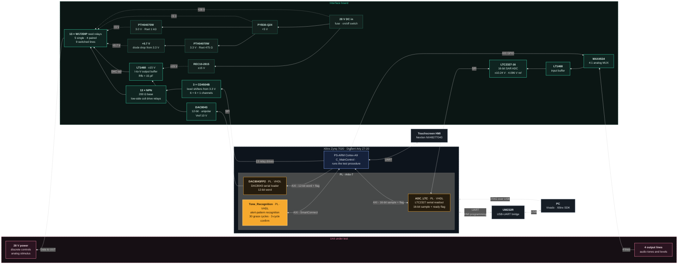
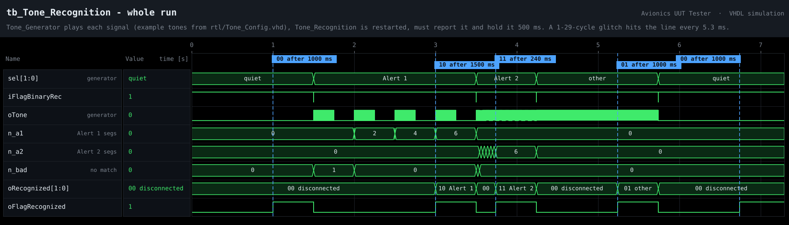
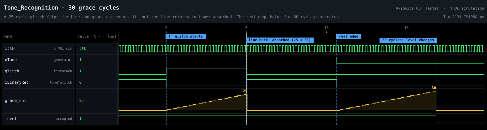
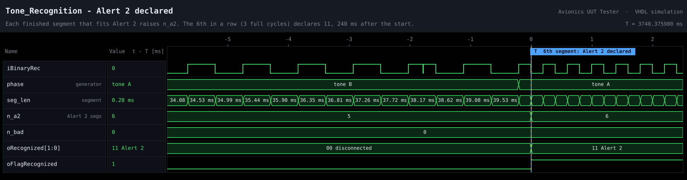
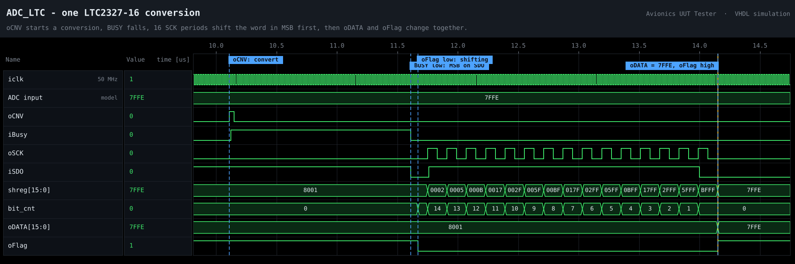
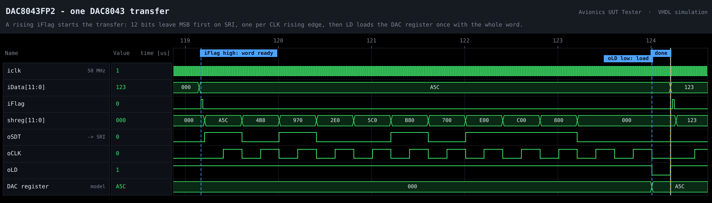

<div align="center">

# Avionics UUT Tester

**FPGA / SoC automatic test equipment for a legacy avionics audio-warning unit**

Zynq-7020 (ARM + FPGA) · VHDL · real-time audio-alert recognition in RTL · AXI · custom analog & relay interface board · bare-metal C


</div>

---

## About this repo

My 2022 practical-engineering final project, re-implemented in 2026 with AI assistance. The architecture and design decisions follow the original: the same four components with the same ports and roles, the same interface board and the same FPGA pin map.

Details specific to the real unit are not published: its connector pinout, its test procedure and its alert tones. The stimulus lines carry generic names (`DIN1` … `DIN7`), the test procedure in [`sw/C_MainControl.c`](sw/C_MainControl.c) is an example, and the tones are example values.

> [!IMPORTANT]
> **Set the alert tones before you use the design.** The tone frequencies and timing in [`rtl/Tone_Config.vhd`](rtl/Tone_Config.vhd) are **examples**, not the original unit's. Put in the values of the unit you test (see [Configuring the tones](#configuring-the-tones)). The RTL, the test-signal generator and the testbench all read that one file.

## The problem

Some avionics systems use a dedicated audio unit to warn the flight crew by sound alone. Maintaining such a unit was a slow, manual, serial process. A technician worked an old test bench with a power supply, a multimeter and many switches, applied each condition by hand, and listened for the right tone pattern. It was cumbersome, time-consuming, and depended on the technician's concentration for the whole run.

## The solution

A semi-automatic tester that replaces the old bench. It is built around a **Xilinx Zynq-7020** (dual ARM Cortex-A9 + Artix-7 fabric, on a Digilent Arty Z7-20) and a custom interface board, powered from a single 28 V DC input:

- **13 reed relays** apply power, discrete levels (0.7 V / 3 V / 5 V / 28 V, ground) and an **analog DAC level** to the unit under test (UUT).
- A **16-bit ADC** behind a 4:1 analog MUX samples the UUT's four outputs.
- **`Tone_Recognition`**, a VHDL component in the FPGA, recognizes the unit's audio patterns: Alert 1, Alert 2, a quiet line, or "something else". Noise tolerance is designed in, so the result no longer depends on a human ear.
- The **ARM** runs the test procedure and guides the technician on a **4.3" touch screen**, which also collects the technician's answers on visual checks.
- A **USB-UART bridge** lets the PC program the touch screen's HMI through the board.

## System architecture



The whole tester runs from one 28 V input: ±15 V, +5 V, 3.3 V, 3 V and 0.7 V are made on the interface board ([docs/interface_board.md](docs/interface_board.md)).

## Highlights

| Feature | Detail |
|---|---|
| **Audio pattern recognition in RTL** | `Tone_Recognition` measures every high and low run of the UUT output at 50 MHz, rides out glitches with **30 grace cycles**, and declares a result only after **3 complete alert cycles** have matched. |
| **Configurable tones** | Tone frequencies and alert timing live in one VHDL package, with assertions that reject inconsistent values at elaboration. |
| **HW/SW partitioning** | Everything with a deadline (ADC timing, DAC load, tone recognition) lives in the PL. The ARM owns the procedure, the relays and the UI. |
| **Safe relay wiring** | Relays switch in pairs: one selects the source, the other connects the UUT line. No relay combination can short two supplies together. |
| **Reproducible** | One script rebuilds the Vivado project, block design, bitstream and XSA from source. Self-checking testbenches cover the ADC, DAC and recognition components. |

---

## Quick start

**Requirements:** AMD Vivado + Vitis (the 2022 original used Vivado and Xilinx SDK). For simulation only, [GHDL](https://github.com/ghdl/ghdl) or [nvc](https://github.com/nickg/nvc) is enough. Optional: [Digilent board files](https://github.com/Digilent/vivado-boards). When they are installed, the build applies the Arty Z7-20 PS preset automatically.

**1. Set your tones** in [`rtl/Tone_Config.vhd`](rtl/Tone_Config.vhd) (see below).

**2. Simulate.** Both testbenches are self-checking and end with `ALL TESTS PASSED`.

```bat
:: Windows: Vivado xsim if Vivado is installed, otherwise GHDL (double-click works too)
sim\run_sim.bat
```

```sh
# Linux / macOS: GHDL or nvc
sh sim/run_sim.sh
```

**3. Build** the Vivado project, bitstream and XSA (takes a few minutes):

```bat
vivado -mode batch -source vivado\build.tcl
```

The result is `build/uut_tester.xsa`. Add `-tclargs bd` to stop after the block design.

**4. Firmware.** In Vitis, create a platform from `build/uut_tester.xsa` (standalone, `ps7_cortexa9_0`), create an empty C application, add the files from `sw/`, build, and run on the board. Replace the example steps in `sw/C_MainControl.c` with your unit's procedure first.

**5. Touch screen.** The Nextion HMI needs one page `main` with text fields `t0`, `t1`, `t2`, progress bar `j0`, and buttons `b0` (OK/START, id 4) and `b1` (FAIL, id 5) - see [`sw/nextion.h`](sw/nextion.h). To upload the HMI, switch SW0 on, connect the UM232R to the PC and upload from the Nextion editor. Switch SW0 off to run tests.

> [!NOTE]
> Vivado's `.bat` launchers abort in a folder whose path contains parentheses, such as a ZIP extracted as `Avionics-UUT-Tester-main (1)`. `run_sim.bat` works around it; for the build, rename the folder first.

## Configuring the tones

[`rtl/Tone_Config.vhd`](rtl/Tone_Config.vhd) defines the two alert patterns:

| Constant | Example | Meaning |
|---|---|---|
| `TONE_A_HZ` | 2500 | tone A, used by both alerts |
| `TONE_B_HZ` | 1100 | tone B, used by Alert 2 |
| `ALERT1_SEG_MS` | 250 | Alert 1 = tone A for this long, then silence for this long, repeating |
| `ALERT2_SEG_MS` | 40 | Alert 2 = tone A for this long, then tone B for this long, repeating |
| `OTHER_HZ` | 5000 | test generator only: a steady tone that must read as "other" |
| `QUIET_MS` | 1000 | no edge for this long = quiet line (or a steady level) |
| `*_TOL_PCT` | 10 / 20 / 30 | tolerances on tone half periods and on segment lengths |

Assertions in `Tone_Recognition` stop elaboration with a clear message if the values cannot work, for example tones too close together or Alert 1 and Alert 2 segments too similar. After changing the values, run the simulation: the testbench computes its expected results from the same file.

The recognizer was checked with several settings, including tone B above tone A. Each one passed all five phases.

---

## Hardware / software partitioning

The tester has to do many things in parallel and at different rates. The ADC is clocked from the 50 MHz system clock while the touch screen talks at 9600 baud. It still has to run a step-by-step procedure, which is easiest to write in C. That is why it uses an FPGA + ARM board.

| Function | Where | Component |
|---|---|---|
| LTC2327 conversion timing (CNV / BUSY / SCK / SDO) | PL | `ADC_LTC` |
| DAC8043 serial load + LD strobe | PL | `DAC8043FP2` |
| Alert recognition | PL | `Tone_Recognition` |
| Test procedure, relays, MUX, touch screen | PS (C) | `C_MainControl` |
| Touch-screen UART routing for HMI programming | PL | `HMI_Prog` |

## The components

The VHDL components are Vivado RTL modules in the block design; `C_MainControl` reaches them through AXI GPIO.

### `ADC_LTC` - [`rtl/ADC_LTC.vhd`](rtl/ADC_LTC.vhd)

Reads the LTC2327-16 continuously at 200 kS/s: CNV pulse, wait for BUSY to fall, shift 16 bits in MSB first.

| Port | Role | Connected to |
|---|---|---|
| `iclk` / `iReset` | 50 MHz system clock / '1' resets everything | clock wizard / Reset button |
| `iSDO` | serial result from the ADC | LTC2327 SDO, IO26 |
| `iBusy` | '1' while a conversion runs | LTC2327 BUSY, IO13 |
| `oCNV` | rising edge starts a conversion | LTC2327 CNV, IO27 |
| `oSCK` | rising edge shifts out the next bit | LTC2327 SCK, IO28 |
| `oDATA` | 16-bit sample, two's complement | `iFromADC` |
| `oFlag` | '1' = `oDATA` can be read | `iFlagFromADC` |

### `DAC8043FP2` - [`rtl/DAC8043FP2.vhd`](rtl/DAC8043FP2.vhd)

On a rising edge of `iFlag`, clocks the 12-bit word into the DAC8043 and pulses LD, so the analog output changes once, with the whole word.

| Port | Role | Connected to |
|---|---|---|
| `iclk` / `iReset` | 50 MHz system clock / '1' resets everything | clock wizard / Reset button |
| `iData` | 12-bit word | `oForDAC` |
| `iFlag` | rising edge = `iData` ready | `oFlagForDAC` |
| `oCLK` | rising edge loads one bit into the input register | DAC8043 CLK |
| `oLD` | loads the input register into the DAC register | DAC8043 LD |
| `oSDT` | serial data | DAC8043 SRI |

### `Tone_Recognition` - [`rtl/Tone_Recognition.vhd`](rtl/Tone_Recognition.vhd)

Decodes the UUT's audio output, given as one bit, into a 2-bit result. See [the tone recognition](#the-tone-recognition) below.

| Port | Role | Connected to |
|---|---|---|
| `iclk` / `iReset` | 50 MHz system clock / '1' resets everything | clock wizard / Reset button |
| `iBinaryRec` | the UUT output as one bit | `oBinaryRec` |
| `iFlagBinaryRec` | rising edge starts a recognition | `oFlagBinaryRec` |
| `oRecognized` | 2-bit result | `iRecognized` |
| `oFlagRecognized` | '1' = `oRecognized` can be read | `iFlagRecognized` |

### `C_MainControl` - [`sw/C_MainControl.c`](sw/C_MainControl.c)

Bare-metal C on the ARM. Runs the test procedure while controlling the relays, the ADC and DAC, the touch screen and the MUX. The procedure is a table of steps; each step sets relays and the DAC, routes one UUT output to the ADC, waits, and runs one check (tone, DC level, line sense or an operator answer).

| Port | Role | Via |
|---|---|---|
| `iFromADC` / `iFlagFromADC` | ADC sample / '1' = new sample | `gpio_adc` ch1 / ch2 |
| `iForPullUp` | DIN5 open or grounded (3.3 V pull-up) | `gpio_relay` ch2 |
| `iTxScreen` / `oRxScreen` | touch-screen UART, 9600 Bd | `uart_screen` |
| `iRecognized` / `iFlagRecognized` | result of `Tone_Recognition` / '1' = valid | `gpio_rec_rx` ch1 / ch2 |
| `oRelayU13` … `oRelayU25` | the 13 relays | `gpio_relay` ch1 |
| `oForDAC` / `oFlagForDAC` | 12-bit DAC word / rising edge = ready | `gpio_dac` ch1 / ch2 |
| `oBinaryRec` / `oFlagBinaryRec` | UUT output as one bit / rising edge = start | `gpio_rec_tx` ch1 / ch2 |
| `oMUXA1` / `oMUXA2` | MUX address bits 1 / 0 (plus MUX enable) | `gpio_mux` |

## FPGA design

The block design is generated entirely by [`vivado/build.tcl`](vivado/build.tcl):

- A Clocking Wizard makes the 50 MHz system clock from the board's 125 MHz oscillator (H16).
- The Reset button (BTN0) feeds a Processor System Reset.
- The Zynq PS7 reaches seven peripherals through an AXI SmartConnect.
- The three components and `HMI_Prog` are RTL modules.

| Peripheral | Address | Channel 1 | Channel 2 |
|---|---|---|---|
| `gpio_relay`  | `0x4120_0000` | out 13: relays U13…U25 | in 1: `iForPullUp` |
| `gpio_mux`    | `0x4121_0000` | out 3: MUX A0, A1, EN | |
| `gpio_adc`    | `0x4122_0000` | in 16: `iFromADC` | in 1: `iFlagFromADC` |
| `gpio_dac`    | `0x4123_0000` | out 12: `oForDAC` | out 1: `oFlagForDAC` |
| `gpio_rec_tx` | `0x4124_0000` | out 1: `oBinaryRec` | out 1: `oFlagBinaryRec` |
| `gpio_rec_rx` | `0x4125_0000` | in 2: `iRecognized` | in 1: `iFlagRecognized` |
| `uart_screen` | `0x4060_0000` | AXI UART Lite, 9600 Bd, to the Nextion screen | |

**HMI programming.** The UM232R USB-UART bridge (IO32 / IO33) is how the PC programs the touch screen. With **SW0** on, [`HMI_Prog`](rtl/HMI_Prog.vhd) connects the screen's UART straight to the UM232R, so the Nextion editor can upload the HMI without unplugging the screen. With SW0 off, the screen talks to `C_MainControl`.

---

## The tone recognition

### What has to be recognized

| `oRecognized` | Signal | Pattern (values from `Tone_Config`) |
|---|---|---|
| `00` | **Disconnected** | quiet line - UUT off or disconnected |
| `01` | **Other** | any other sound, e.g. a steady tone |
| `10` | **Alert 1** | tone A gated on/off, `ALERT1_SEG_MS` on / `ALERT1_SEG_MS` off |
| `11` | **Alert 2** | tone A alternating with tone B, `ALERT2_SEG_MS` each |

### How it works

`C_MainControl` turns each ADC sample into one bit and hands it to `Tone_Recognition`. The component counts how many clock cycles each '1' and each '0' lasts and classifies every run as a tone A half period, a tone B half period, a quiet gap or other. Consecutive runs of one class form a segment, and each finished segment is checked against both alert patterns.

### Why it is harder than it looks

The first version of the recognizer did not work on the bench, not even with clean, generated test signals. The input is sampled far faster than the tones change (50 MHz against tones in the kHz range), so **a single noisy sample looks like a real edge**. A one-sample spike splits one half period into short runs, and a naive counter reports nonsense. Two mechanisms fixed it:

1. **30 grace cycles.** When the level changes, counting goes on for 30 more clock cycles. If the input returns to the old level within them, it was a glitch and the cycles are added to the old level's counter. If it does not, the old run ends and the grace cycles are added to the new level's counter, so the measured lengths stay exact.
2. **3-cycle confirmation.** A result is declared only after 3 complete alert cycles have matched (6 consecutive segments), not after one. A single disturbed segment can delay a result but not cause a wrong one.

### Bench test

To develop the recognizer, a test program generated the four signals in the FPGA, selected by two switches. On the scope each came out as a clean square wave. The same generator, [`sim/Tone_Generator.vhd`](sim/Tone_Generator.vhd), drives the simulation below and is synthesizable, so it can still be used on the board.

### Simulation

| Testbench | Covers |
|---|---|
| [`tb_Tone_Recognition`](sim/tb_Tone_Recognition.vhd) | `Tone_Generator` plays quiet → Alert 1 → Alert 2 → other → quiet, while 1-29-cycle glitches hit the line every 5.3 ms. Each phase must give the matching code. Alert 1 / Alert 2 must not be declared before 3 full cycles. The result must then hold for 500 ms while the signal goes on. |
| [`tb_ADC_DAC`](sim/tb_ADC_DAC.vhd) | `ADC_LTC` and `DAC8043FP2` against bus-functional models of the LTC2327 (BUSY, MSB-first SDO with output delay) and the DAC8043 (shift on CLK, load on LD): words through the serial chain, 200 kS/s, flag timing, and a DAC write made during a transfer. |

Output with the example tones (nvc 1.14):

```text
PASS  ADC_LTC reads 0x8001 through the serial chain
PASS  ADC_LTC reads 0x7FFE
PASS  ADC_LTC samples at 200 kS/s (20 samples in 100 us)
PASS  oDATA changes only with a rising oFlag
PASS  DAC8043FP2 sends 0xA5C in 12 clocks, then LD
PASS  first word of a back-to-back pair: 0x123
PASS  word written during a transfer is sent next: 0x456
tb_ADC_DAC: ALL TESTS PASSED
tones: A 2500 Hz, B 1100 Hz, Alert 1 segments 250 ms, Alert 2 segments 40 ms, grace 30 cycles
PASS  quiet   -> 00 after 1000 ms, held 500 ms
PASS  alert 1 -> 10 after 1500 ms, held 500 ms
PASS  alert 2 -> 11 after 240 ms, held 500 ms
PASS  other   -> 01 after 1000 ms, held 500 ms
PASS  quiet   -> 00 after 1000 ms, held 500 ms
tb_Tone_Recognition: ALL TESTS PASSED
```

The same run with the grace cycles disabled (`-gG_GRACE=1`) fails 4 of the 5 phases: the injected glitches turn into edges and every signal reads as `01`. This is the bench failure described above, and the grace cycles are what fix it.

### Waveforms

Logic-analyzer views of the same simulation, drawn from the simulator's wave dump by [`sim/ila_plot.py`](sim/ila_plot.py) (`python sim/ila_plot.py`, needs GHDL or nvc, and matplotlib). The tone testbench runs at 5 MHz instead of 50 MHz to keep the simulation fast; all times in seconds are the same.

**The whole run** - each signal, the counters of matching segments, and each result held for 500 ms:



**30 grace cycles** - a glitch shorter than 30 cycles is absorbed; a real edge is accepted after 30:



**Alert 2 declared** on the 6th matching segment in a row:



**ADC_LTC** reading one LTC2327-16 conversion, and **DAC8043FP2** loading one word:





---

## Interface board

Power tree (28 V → ±15 V, +5 V, 3.3 V, 3 V, 0.7 V), measurement chain (MUX → buffer → ADC), stimulus chain (DAC → I-to-V buffer, 13 reed relays behind level shifters and NPN drivers), relay map and pin map: **[docs/interface_board.md](docs/interface_board.md)**.

## Repository layout

```text
rtl/        Tone_Config (alert tones - set yours), Tone_Recognition, ADC_LTC, DAC8043FP2, HMI_Prog
sim/        Tone_Generator, self-checking testbenches, run_sim.bat / run_sim.sh, ila_plot.py
vivado/     build.tcl (project + block design + implementation), pin constraints
sw/         C_MainControl (example test procedure, hardware map), Nextion driver
docs/       interface board, waveform images
```

## License

[MIT](LICENSE)

---

<div align="center">
<sub>Original design: Ofir Sipouren, 2022 · Re-implementation with AI assistance, 2026</sub>
</div>
