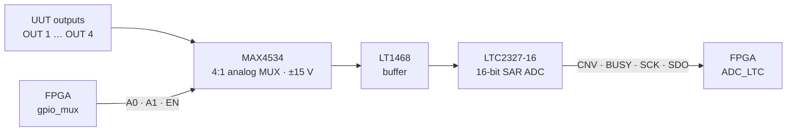

# Custom interface board

The Arty Z7-20 cannot touch the UUT directly: the unit runs from 28 V, expects
discrete inputs at 0.7 V / 3 V / 5 V / 28 V and an analog level, and produces
audio-frequency and DC outputs of several volts. The interface board does the
translation. It was designed in OrCAD.

The stimulus lines are named generically here (`DIN1` … `DIN7`, `AUX`), and
the outputs `OUT 1` … `OUT 4`. Map them to your own unit's connector.

## Power tree

The whole tester runs from a single **28 V DC** input (fuse, ON/OFF switch),
the same supply the UUT needs.

| Regulator | In | Out | Feeds |
|---|---|---|---|
| RECOM REC10-2815DRWZ | 28 V | ±15 V | MAX4534 MUX, LT1468 op-amps |
| PYB30-Q24-T512 (isolated DC-DC, 4:1 input) | 28 V | +5 V | LTC2327 Vdd, DAC8043, relay coils, Nextion, UM232R |
| TI PTH04070W (×2) | 5 V | 3.3 V (R = 475 Ω) / 3 V (R = 1 kΩ) | logic rails, 3 V stimulus level |

The 0.7 V stimulus level is a forward-biased diode fed from 3.3 V through a
resistor.

## Measurement chain (UUT → FPGA)



* **MAX4534** - fault-protected analog MUX on ±15 V, so a UUT output that
  swings beyond the logic rails cannot damage anything. `A0 / A1 / EN` come
  from the FPGA (IO36-38).
* **LT1468** - 90 MHz, 16-bit-accurate op-amp as a buffer: protects the board
  from high currents, presents a high impedance to the UUT and a low
  impedance to the ADC's sampling capacitor.
* **LTC2327-16** - 16-bit SAR ADC, pseudo-differential bipolar input
  **±10.24 V** (±2.5 × REFBUF, REFBUF = 4.096 V), 312.5 µV/LSB,
  two's-complement output, OVdd = 3.3 V so its pins talk to the FPGA
  directly. CHAIN and RDL/SDI are tied low (normal, single-device mode).

## Stimulus chain (FPGA → UUT)

* **DAC8043** (U3) - 12-bit serial multiplying DAC in **unipolar** mode with
  Vref = 10 V, so the output runs from 0 to −Vref × 4095/4096. An LT1468 (U6)
  on ±15 V converts its output current to a voltage (Rfb, 15 pF). The level
  reaches the UUT on `DIN2` through relay U18.
* **13 × W172DIP-21 reed relays** (U13-U25) - fast, low coil current, long
  life. Each coil is switched by an NPN transistor (200 Ω base resistor)
  driven from a **CD4504B** level shifter (U26-U28: 6 + 6 + 1 channels) that
  converts the FPGA's 3.3 V logic.

### Relay pairs

Five relays switch a line on their own. The other eight work in **pairs**: the
second relay connects the UUT line, the first picks what it connects to. Both
off = line open. Because the "select" relay only ever chooses one source, no
combination of relay states can short two supplies together.

```text
            select relay (e.g. U15)          connect relay (e.g. U16)
  +28 V ───── NO ┐
                 ├── COM ─────────────────────── NO ┐
  +0.7 V ──── NC ┘                                  ├── COM ───── UUT line (DIN1)
                                            (open) NC ┘

  select off, connect on  -> DIN1 = +0.7 V
  select on,  connect on  -> DIN1 = +28 V
  connect off             -> DIN1 open
```

Each coil: FPGA IOn → CD4504B (3.3 V → 5 V) → 200 Ω → NPN base; the NPN
switches the coil's low side, the coil sits on +5 V.

### Relay map

| Relay | FPGA | Line | Function |
|---|---|---|---|
| U13 | IO0  | UUT power | +28 V / open |
| U14 | IO1  | AUX  | +28 V / open |
| U15 | IO2  | DIN1 | select: +28 V / +0.7 V |
| U16 | IO3  | DIN1 | connect |
| U17 | IO4  | DIN2 | +28 V / open |
| U18 | IO5  | DIN2 | DAC level (U6 output) instead of U17 |
| U19 | IO6  | DIN3 | +0.7 V / open |
| U20 | IO7  | DIN4 | select: +28 V / +0.7 V |
| U21 | IO8  | DIN4 | connect |
| U22 | IO9  | DIN5 | GND / open |
| U23 | IO10 | DIN6 | select: +3 V / +0.7 V |
| U24 | IO11 | DIN6 | connect (off = the line's return) |
| U25 | IO12 | DIN7 | +5 V / open |

CD4504B channels: U26 A-F → U13-U18, U27 A-F → U19-U24, U28 A → U25.

### Line states

| Line | open | +0.7 V | +3 V | +28 V | other |
|---|---|---|---|---|---|
| DIN1 | — | U16 | | U15 + U16 | |
| DIN2 | — | | | U17 | DAC level: U18 |
| DIN4 | — | U21 | | U20 + U21 | |
| DIN6 | | U24 | U23 + U24 | | return: — |

The same masks are defined in [`sw/C_MainControl.h`](../sw/C_MainControl.h)
(`DIN1_28V`, `DIN2_DAC`, `DIN6_3V`, ...), so a test step reads like the
schematic.

### DIN5 sense

`DIN5` also has a 3.3 V pull-up to FPGA IO39 (`PullUpCont`). Reading it
(`iForPullUp`) tells C_MainControl whether the line is open or grounded, which
lets the tester check its own relay before it relies on it.

## FPGA pin map (Arty Z7-20 ChipKit headers)

| IO | Pin | Signal | Dir | IO | Pin | Signal | Dir |
|---|---|---|---|---|---|---|---|
| 0-12 | T14 … P18 | `RelayCont_1..13` | out | 32 | V8  | `UM232R_TX` | in  |
| 13 | N17 | `ADC_BUSY` | in  | 33 | V10 | `UM232R_RX` | out |
| 26 | U5  | `ADC_SDO`  | in  | 34 | W10 | `LCD_RX`    | out |
| 27 | V5  | `ADC_CNV`  | out | 35 | W6  | `LCD_TX`    | in  |
| 28 | V6  | `ADC_CLK`  | out | 36 | Y6  | `MUX_A0`    | out |
| 29 | U7  | `DAC_SDI`  | out | 37 | Y7  | `MUX_A1`    | out |
| 30 | V7  | `DAC_CLK`  | out | 38 | W8  | `MUX_EN`    | out |
| 31 | U8  | `DAC_LD`   | out | 39 | Y8  | `PullUpCont` | in |

On the board itself: H16 = 125 MHz clock, BTN0 = Reset, SW0 = HMI programming.
Full constraints: [`vivado/arty_z7_20.xdc`](../vivado/arty_z7_20.xdc).
